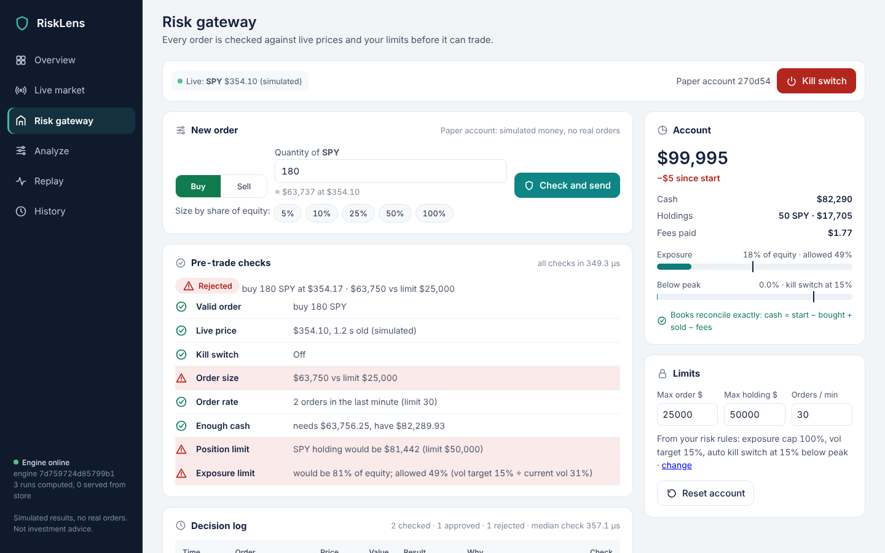
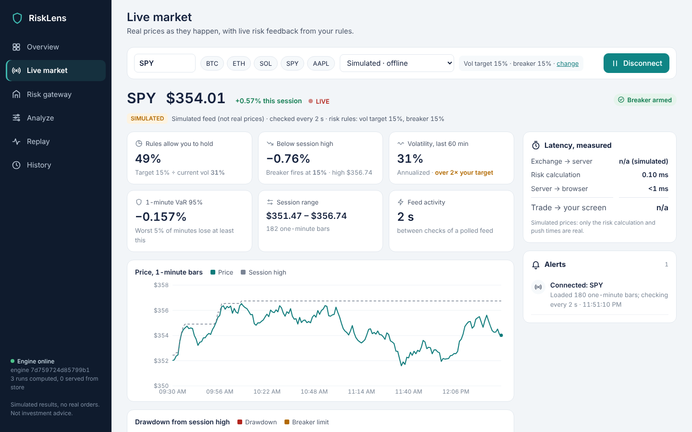
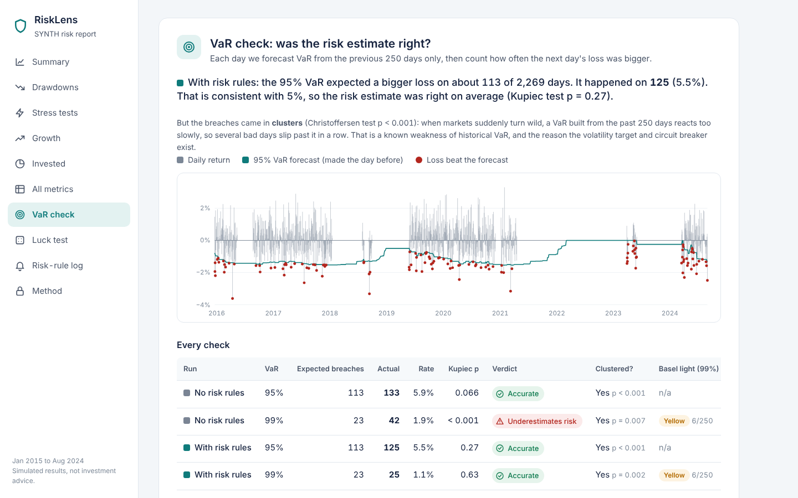
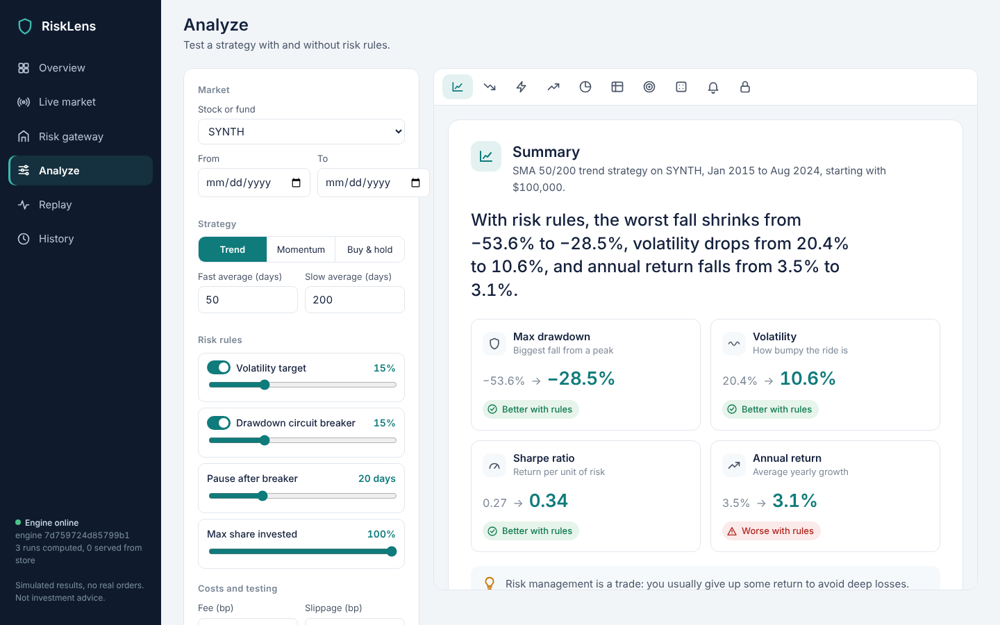
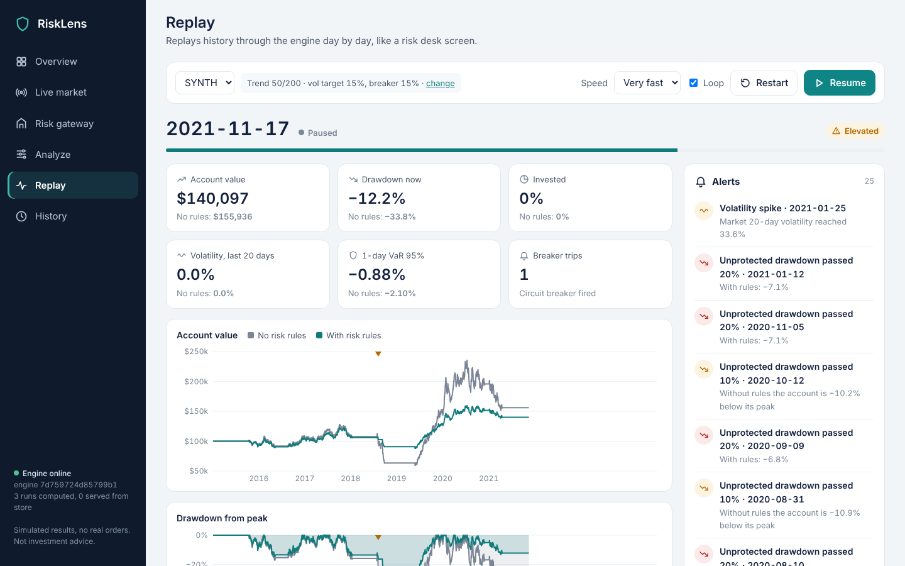

# RiskLens

**Risk management for trading strategies: tested through real market
crashes, checked against live prices, and proven correct by its own tests.**

[](https://github.com/YOUR-GITHUB-USERNAME/risklens/actions/workflows/tests.yml)
&nbsp;Python 3.11–3.13 · engine in pure standard-library Python · 125 tests ·
17/17 planted bugs caught

**Live demo:** _add your hosted link here (see [Deploy](#deploy))_ ·
Built at HackRU Fall 2026 for the Lucera Trading Systems Challenge



## What it does

RiskLens answers the questions a risk manager asks about a trading strategy,
on historical data and on live prices:

| Question | Feature |
|---|---|
| **How risky is it, and what do risk rules buy you?** | **Analyze** backtests the strategy twice, without and with risk rules (volatility target, exposure cap, drawdown circuit breaker), and compares max drawdown, volatility, VaR, Expected Shortfall and returns, plus stress tests through real crashes (2008, COVID, 2022). |
| **Was the risk estimate right?** | **VaR check** backtests the risk model itself, the way banks must: each day's VaR is forecast from the past 250 days only, then the Kupiec test (right number of breaches?), Christoffersen test (do breaches cluster?) and the Basel traffic light grade it. |
| **Is the strategy's edge real, or luck?** | The **luck test** shuffles its timing 1,000 times and reports a p-value. |
| **What do my rules say right now?** | **Live market** streams every trade from Coinbase's public WebSocket (Yahoo for stocks, delayed) and recomputes the allowed exposure, drawdown vs. the breaker, 60-minute volatility and 1-minute VaR on each update, with alerts and a measured latency breakdown. |
| **Should this order be allowed?** | The **Risk gateway** runs every order through eight pre-trade checks (fresh price, kill switch, fat-finger size, order rate, cash, no shorting, position limit, exposure limit) on a paper account, with a **kill switch** that trips automatically on a drawdown and flattens the position. |
| **What happened, day by day?** | **Replay** streams 10+ years through the engine like a risk desk screen, with alerts when the breaker fires. |

**Core claim: you can trust the numbers.** RiskLens

* **cannot look ahead.** A strategy only ever holds the bars up to today,
  orders decided at today's close fill at *tomorrow's open*, and each VaR
  forecast uses only earlier days.
* **always balances the books.** Backtest money is integer cents; gateway
  money is exact fractions. Cash, positions and fees reconcile exactly after
  every trade.
* **never approves an order that breaks a limit**, tested over thousands of
  random order sequences.
* **is reproducible.** Same config, same data snapshot and same engine code
  always give the same run ID and the identical result.

We do not claim to predict the market. The strategies are deliberately simple
(trend-following moving averages, momentum, buy-and-hold). The product is the
*measurement and control of risk*, done in a way you can verify.

| Live market | VaR check |
|---|---|
|  |  |
| **Analyze** | **Replay** |
|  |  |

The engine, server and app are pure Python standard library. `pytest` +
`hypothesis` for tests; `yfinance` to download real price data;
`websocket-client` only for the Coinbase live feed. Screenshots use the
built-in synthetic dataset and the clearly labeled simulated feed.

---

## 1. Quick start

```bash
python3 -m pip install -r requirements-dev.txt   # pytest, hypothesis (tests only)

./scripts/demo.sh            # server + client: strategy without vs with risk rules,
                             # prints a comparison table and writes an HTML report
python3 -m pytest -q         # 125 tests, ~25 s
./scripts/mutation_check.sh  # plants 17 bugs, shows the tests catch every one
python3 bench/bench.py       # every number in PERFORMANCE.md (~90 s)
python3 -m risklens.server   # then open http://127.0.0.1:8765/
```

**Live crypto prices** for the Live market screen (needs internet):
```bash
pip install websocket-client
```

**Real market data** (recommended for the demo; needs internet once):
```bash
pip install yfinance
python3 scripts/fetch_data.py AAPL SPY --start 2010-01-01 --end 2024-12-31
./scripts/demo.sh AAPL
```
The data is downloaded **once**, frozen to `data/AAPL.csv`, and its SHA-256 is
recorded in `data/manifest.json`. Backtests always run from that frozen
snapshot, never from a live API, so they are reproducible and work offline.
The server refuses to start if a file no longer matches its recorded hash.

### Deploy

RiskLens runs as a public website with one command, `python -m risklens.server --public`:
it listens on `$PORT`, and adds per-visitor rate limits, caps on live streams
and luck-test size, a bounded result store, and one paper account per browser.
Only the synthetic dataset ships in the repo, and Yahoo is disabled on the
public server (crypto streams from Coinbase).

* **Render (free):** push this repo to GitHub, then on render.com choose
  **New → Blueprint** and pick the repo. `render.yaml` does the rest.
* **Railway / Heroku-style hosts:** use the `Procfile`.
* **Fly.io, Cloud Run, any Docker host:** use the `Dockerfile`.

Using the client directly (server running in another terminal: `python3 -m risklens.server`):
```bash
python3 -m risklens.client datasets
python3 -m risklens.client compare AAPL --strategy sma_cross --fast 50 --slow 200 \
        --vol-target 0.15 --max-drawdown 0.15 --open
python3 -m risklens.client compare SPY --strategy momentum --lookback 126
python3 -m risklens.client run AAPL --strategy buy_and_hold --no-risk
```

---

## 2. Architecture

```
  analysts / scripts                        RiskLens run server (one process)
 ┌──────────────────┐   POST /runs {cfg}   ┌────────────────────────────────────────┐
 │ client.py (CLI)  │ ───────────────────▶ │ server.py   validate config (strict)   │
 │ compare / run /  │                      │   run_id = sha256(config, data hash,   │
 │ show / datasets  │ ◀─────────────────── │                    engine version)     │
 └──────────────────┘   summary, run id    │   cached? return stored result         │
          │                                │   else  runner.execute ──┐             │
          │ GET /report?runs=a,b           │                          ▼             │
          ▼                                │   engine.py  day-by-day simulation     │
   reports/*.html  ◀────────────────────── │   metrics.py risk metrics + luck test  │
   (charts, tables)                        │   results/<run_id>.json  (immutable)   │
                                           │   data/*.csv + manifest.json (hashed)  │
                                           └────────────────────────────────────────┘
   scripts/fetch_data.py ── yfinance (once) ──▶ data/AAPL.csv + SHA-256 in manifest
```

The live market path (a third component talking to the outside world):
```
 Coinbase Exchange               RiskLens server                         browser
 ws-feed (every trade) ──WSS──▶  reader thread: trades → 1-min bars
 REST 1-min candles ───HTTPS──▶  backfill + refill gaps after a drop
                                 stream loop: wakes on each trade,       ──SSE──▶ Live market page
                                 recompute risk snapshot (~0.1 ms),               KPIs, charts, alerts,
                                 alerts on threshold crossings,                   latency panel
                                 stamp latency, push (Nagle off)
 Yahoo Finance (stocks) ─poll 20 s─▶ same stream loop
```

| Component | Responsibility |
|---|---|
| `data.py` | Strict CSV loader (rejects unsorted/duplicate dates, bad prices, NaN), SHA-256 fingerprints, seeded synthetic data |
| `strategies.py` | `History` view (past bars only) and three simple strategies |
| `engine.py` | The day-by-day loop: fills, accounting in cents, risk rules, per-day invariant checks. **No I/O, no clock, no randomness** |
| `metrics.py` | Every metric with one written definition; the luck test |
| `runner.py` | Strict config validation, canonical form, content-addressed run IDs |
| `server.py` | HTTP/JSON service owning the data snapshots and the immutable result store |
| `gateway.py` | Pre-trade risk gateway: eight checks, paper accounts in exact fractions, kill switch (manual and automatic) |
| `market.py` | Live market: Coinbase WebSocket / Yahoo / simulated feeds, live risk snapshot, alert crossings, latency stamps |
| `live.py` | Replay: steps the engine day by day through an observe-only hook and emits snapshots with rolling risk metrics |
| `webapp.py` | The single-page web app served at `/` (Overview, Live market, Analyze, Replay, History) |
| `client.py`, `report.py` | CLI and self-contained HTML report with charts |

**Why a server and a client (two components):** on a real quant team many
people run backtests. One server holds the canonical data snapshots and an
immutable, content-addressed result store. Two people who submit the same run
get the *same stored result with the same ID*, not two slightly different
local runs, and nobody can quietly re-run on edited data.

### A trading day inside the engine
1. **Open:** execute the order decided at yesterday's close, at today's open
   price ± slippage, plus a fee. If an overnight gap makes it unaffordable,
   it is shrunk (no leverage, ever).
2. **Close:** mark the position to the close; update peak equity and drawdown.
3. **Circuit breaker:** if equity is `max_drawdown` below its peak, go flat at
   the next open and stay flat for `cooldown_days`, then re-arm from there.
4. **Decide:** today's bar is appended to the strategy's `History` (tomorrow is
   *not in memory it can reach*). The strategy returns a target exposure
   (0–100% of equity). Risk rules adjust it: **volatility targeting** scales
   it by `vol_target / realized 20-day vol`, the **exposure cap** limits it,
   and a halt forces 0. The resulting order waits for the next open.

---

## 3. Correctness: claims and evidence

| # | Invariant | Evidence |
|---|---|---|
| I1 | **No look-ahead.** A decision on day *k* depends only on bars 0..*k*. | `test_no_look_ahead`: Hypothesis builds random markets, **replaces every bar after day k with different prices**, and checks every decision, equity value and trade up to day *k* is unchanged. Also `test_history_has_no_future` (tomorrow is physically absent) and the fill-at-next-open fixtures. |
| I2 | **Books balance to the cent.** `cash = start − buys + sells − fees` every day; `equity = cash + shares × close`; cash ≥ 0; no shorts. | Checked inside the engine **every day** (`check=True`), plus `test_books_always_balance`, which rebuilds cash and position from the trade list alone (an independent ledger) over hundreds of random markets, costs, risk settings and strategies. |
| I3 | **Risk rules always hold.** Target ≤ exposure cap; zero exposure and no buys while the breaker is halted. | `test_risk_rules_always_respected` (random), and hand-calculated breaker, cap and vol-target tests. |
| I4 | **Deterministic and reproducible.** Same inputs ⇒ same result fingerprint and run ID; any change to config, data or engine code ⇒ new run ID. | `test_deterministic`, `test_execute_is_deterministic`, `test_run_id_covers_config_data_and_engine`, the server's `cached` path, and the benchmark's fingerprint check. |
| I5 | **Metrics mean what they say.** | Hand-calculated tests for drawdown (dates and recovery), nearest-rank VaR/CVaR, volatility and Sharpe, and the luck test (perfect foresight ⇒ p < 0.01; constant exposure ⇒ p = 1). |
| I6 | **Bad input is rejected, not "fixed".** | Data loader tests (unsorted, duplicate, negative, NaN, high < close…), 11 rejected server configs, NaN in JSON, oversized bodies, path traversal, tampered data file. |
| I7 | **The live replay tells the same story as the backtest.** Streamed account values equal the batch engine's to the cent, and resuming from any day gives exactly the same stream. | `test_stream_matches_batch_engine`, `test_resume_from_middle_is_identical`. |
| I8 | **The live feed never invents or drops prices silently.** Trades build exact 1-minute bars (open = first, high/low = extremes, close = last, volume = sum); other products are ignored; a dropped connection is announced and the missed minutes are refilled from the exchange's own candles; a bad symbol stops with a clear message instead of retrying forever; the socket is closed when the browser leaves. Live risk numbers use the same definitions as the backtest. | `tests/test_market.py` (20 tests) against a fake socket speaking Coinbase's message format: bar building, reconnect and gap fill, stock symbols refused, end-to-end push stream, hand-calculated volatility, nearest-rank VaR, breaker states and once-per-crossing alerts. |
| I9 | **The risk estimate is checked honestly.** Each day's VaR forecast uses only the 250 days before it, never the day being forecast; the Kupiec, Christoffersen and Basel numbers match hand calculations. | `tests/test_var_check.py`: Hypothesis changes the forecast day and everything after it and proves earlier forecasts don't move; the rolling forecast equals a from-scratch VaR on every window; known chi-square critical values; a correct model passes, a model that lags rising volatility is flagged "underestimates risk", and bursty volatility is flagged as clustered even when the count looks fine. |
| I10 | **No approved order ever breaks a limit.** An order fills only if all eight pre-trade checks pass; no buy while the kill switch is engaged or without a fresh price (fail closed); the paper account never goes negative or short, and `cash = start − bought + sold − fees` holds exactly (fractions, no rounding). | `test_no_approved_order_ever_breaks_a_limit`: Hypothesis runs 250 random sequences of orders, price moves, volatility changes, limit changes, kill/re-arm and time jumps, and checks every limit and the reconciliation after each step. Plus one test per check, the boundary case where fees tip an order over the exposure limit, manual and automatic kill switch, and per-browser account isolation. |

**Do the tests have teeth?** `scripts/mutation_check.sh` plants 17 realistic
bugs one at a time (strategy sees tomorrow's bar, fills at the close instead
of the next open, fee not charged, leverage allowed, breaker ignored, cap
ignored, vol targeting ignored, peak never updated, VaR off by one, luck-test
tie handling, VaR forecast peeks at the day it forecasts, Kupiec p-value from
the wrong distribution, gateway ignores the kill switch, gateway ignores the
position limit, exposure checked before fees, trading on a stale price, run
ID ignoring the data hash). **Result: 17/17 caught**, and CI fails if any
survives. Twice a survivor exposed a weak test (the breaker test, and the
exposure-limit boundary), and we strengthened it.

**Real bugs the tests and benchmarks caught during the hackathon:**
* `ceil((1 − 0.95) × 40)` is **3**, not 2, in floating point
  (`0.05 × 40 = 2.0000000000000018`), so VaR silently used the wrong day. The
  hand-calculated VaR test caught it; fixed by rounding before `ceil`.
* A price below half a cent rounds to $0.00 and crashed position sizing
  (division by zero). The 1,000-year benchmark found it; such days now
  send no order, with a regression test.

Results: **125 tests pass** (`python3 -m pytest -q`, ~25 s; full output in
`tests/RESULTS.txt`), on CPython 3.11, 3.12 and 3.13.

### Metric definitions (all from daily close-to-close equity returns, 252 days/year)
* **Volatility:** sample std × √252. **Sharpe:** mean / std × √252, risk-free rate 0.
  **Sortino:** same with downside deviation.
* **Max drawdown:** largest fall from a running peak, with peak/trough dates
  and days to recover.
* **VaR 95% (1-day, historical):** the k-th worst day, k = ⌈5% × n⌉.
  **CVaR / Expected Shortfall:** the average of those k worst days.
* **VaR check (backtesting the risk model):** for each day t, forecast the
  1-day VaR from days t−250…t−1 only; an exception is a loss bigger than the
  forecast. **Kupiec** tests whether the exception rate fits 5% (or 1%);
  **Christoffersen** tests whether exceptions cluster; the **Basel traffic
  light** grades 99% VaR by exceptions in the last 250 days (green 0–4,
  yellow 5–9, red 10+).
* **Luck test:** shuffle the strategy's daily exposure across days 1,000 times
  (keeps *how much* it invested, randomizes *when*); p-value = share of
  shuffles whose Sharpe ≥ the real one. Gross of costs, seeded.

---

## 4. Performance (summary; full report in [PERFORMANCE.md](PERFORMANCE.md))

2-vCPU Intel Xeon VM, Linux, CPython 3.13; engine pinned to one core;
server on CPU 0, clients on CPU 1 (live and gateway rows: a 2.1 GHz VM).

| Measurement | Result |
|---|---|
| Engine speed (SMA + vol target + breaker, invariants checked daily) | **~180,000 bars/s**, flat from 10 to 1,000 years of data |
| One 10-year backtest | load 10 ms · simulate **12 ms** · luck test 852 ms |
| Memory | ~169 bytes per bar simulated |
| Server: cached result, 1 client | p50 **2.0 ms**, p99 3.6 ms |
| Server: cached result, 8 concurrent clients | 455 req/s, p50 16 ms, p99 33 ms |
| Server: new run (computed) | p50 914 ms (dominated by the luck test) |
| Live market: trade arrives → risk update reaches the browser's socket (server pipeline, loopback) | p50 **0.88 ms**, p99 2.1 ms |
| Live market: risk snapshot per update | 0.05 ms (300 bars) to 0.18 ms (a full day of 1,440 bars) |
| Risk gateway: all eight pre-trade checks + fill, in process | p50 **72 µs**, p99 127 µs (~14,600 orders/s) |
| Risk gateway: order round trip over HTTP | p50 1.6 ms, p99 2.3 ms |

**Live latency, end to end.** The server adds about 1 ms. What dominates is
the internet between Coinbase and your laptop (typically tens of ms), which
the app measures and shows live, alongside the rest of the breakdown.
Yahoo's free stock data is about a minute delayed, so for stocks the honest
answer is "a minute", and the app says so.

**Bottleneck:** the simulation itself is cheap. **97% of a run is the luck
test** (1,000 shuffles in pure Python, linear in trials: 100 → 0.10 s,
5,000 → 4.3 s). Next step: vectorize it with NumPy, or adaptively stop once
the p-value is clearly decided.

---

## 5. Limitations (honest list)

* **Daily bars, one stock, long-only, no leverage.** No shorting, no
  portfolios of many stocks, no intraday data.
* **Simple fill model:** fills at the next open ± fixed slippage. No partial
  fills, no volume or market-impact model, no borrowing costs.
* **Adjusted prices** from Yahoo Finance (splits/dividends folded into the
  price). Dividends are not paid as cash; delisted stocks are missing
  (survivorship bias). Dates are trading days in the file; no holiday calendar.
* **The breaker re-arms after cooldown**, so it limits each losing *episode*
  to about `max_drawdown`. The total peak-to-trough loss across several
  episodes can be larger (e.g. 28.5% with a 15% breaker in the synthetic demo).
  That is shown, not hidden.
* **The luck test** ignores costs and assumes days are exchangeable, which
  breaks with volatility clustering. Treat it as a sanity check, not proof of
  an edge. Testing many strategies inflates false positives
  (multiple-comparisons); there is no correction yet.
* **Server:** no authentication (binds to localhost by default; `--public`
  adds rate limits, not logins). Locally the result store has no size limit,
  and every cache hit re-reads its JSON file from disk.
* **VaR check:** historical VaR with a fixed 250-day window, 1-day horizon;
  the Basel light is applied to the strategy's own VaR, not a bank's
  regulatory model. Short datasets (under 300 days) are reported as "not
  enough data" rather than tested.
* **Risk gateway:** a paper account in memory (lost on restart), market
  orders only, fills at the last live price plus fixed slippage (no order
  book, no partial fills). One account per browser; no login.
* **Live market:** real-time only for crypto (Coinbase). Stocks use Yahoo's
  free, delayed data, and US markets are closed nights and weekends. The
  session window for crypto is the last 5 hours of candles plus live trades.
  Exchange → server latency compares Coinbase's timestamps with your PC
  clock, so it is only as accurate as that clock (usually within a few ms).
  Each open browser tab holds its own connection to Coinbase. Live feedback
  is advisory: no orders are placed.

## 6. Next steps
1. NumPy luck test (the measured bottleneck), plus a block-bootstrap version
   that respects volatility clustering.
1. A VaR model that reacts faster to volatility (EWMA or GARCH), compared
   against historical VaR with the same VaR check; the check already shows
   historical VaR breaches cluster.
2. Multi-asset portfolios with a portfolio-level VaR limit.
3. Walk-forward testing: tune on one period, test on the next, automatically.
4. In-memory cache of hot results in the server.

---

## 7. Disclosure: what we built vs. what we used

**Built during HackRU (Oct 10–11, 2026):** all code in this repository:
engine, risk rules, metrics, luck test, VaR check, data validation, server,
client, report, web app, live market feeds, risk gateway, tests, mutation
script, benchmarks, demo, deploy config.

**Used, not built:**
* Python standard library (`http.server`, `json`, `hashlib`, `csv`, `random`…).
* `pytest` and `hypothesis` (tests only); `yfinance` (data download, and the
  delayed stock feed in Live market); `websocket-client` (the Coinbase live feed).
* **Data:** Yahoo Finance daily prices via `yfinance`, read-only and subject to
  Yahoo's terms. Downloaded files are git-ignored and not redistributed.
  `SYNTH` is synthetic data from a fixed seed, clearly labeled as not real.
  **Live crypto prices:** Coinbase Exchange's public market-data WebSocket and
  public 1-minute candles (no account, no API key), displayed live, not
  stored or redistributed, subject to Coinbase's terms. We did not use
  TradingView: it has no public data API, and scraping it would break its terms.
* **AI assistance:** the code and docs were developed with help from an AI
  coding assistant (Claude), and reviewed, run and tested by the team.
* **Simulation only:** no real orders, no brokerage connection, no real money,
  no credentials.

## Repository layout
```
risklens/   data.py strategies.py engine.py metrics.py runner.py server.py client.py report.py
            webapp.py (the app) live.py (replay) market.py (live market feeds + live risk)
            gateway.py (pre-trade risk checks, kill switch, paper account)
tests/      test_engine.py test_properties.py test_metrics_data.py test_server.py test_live.py
            test_market.py test_var_check.py test_gateway.py test_public.py helpers.py
docs/img/   screenshots
.github/    workflows/tests.yml (tests on 3.11-3.13 + mutation check)
render.yaml Procfile Dockerfile requirements.txt   (deploy)
bench/      bench.py results/*.json
scripts/    demo.sh fetch_data.py mutation_check.sh
data/       SYNTH.csv manifest.json   (+ your fetched AAPL.csv, SPY.csv, git-ignored)
```
